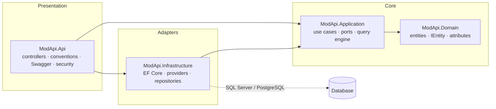
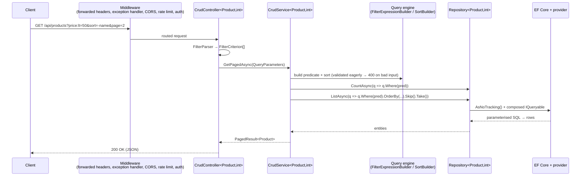
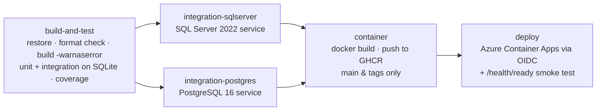
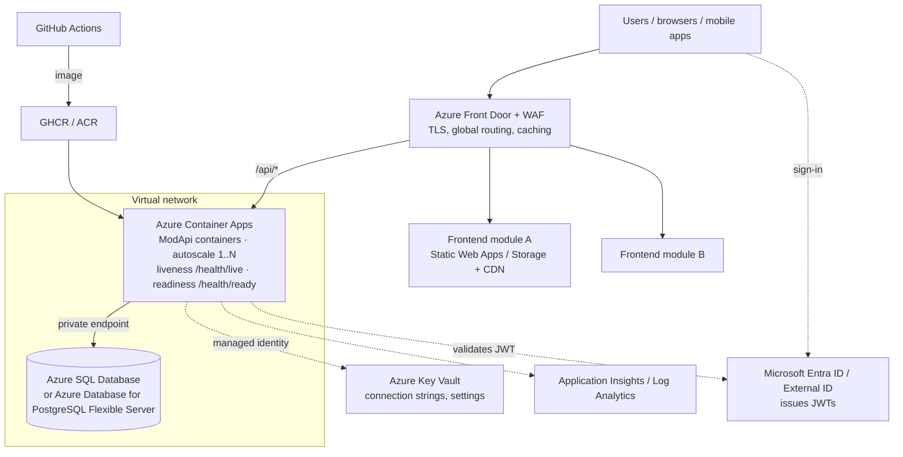

# ModApi

[](https://github.com/OWNER/REPO/actions/workflows/ci-cd.yml)

A generic **.NET 8 REST API** that gives every entity full **CRUD** endpoints over **SQL Server** or **PostgreSQL** with no per-entity code. The provider is chosen from configuration. Data access uses **Entity Framework Core** and **LINQ** throughout. The API is designed to sit behind any number of independent, **modular frontends**.

```text
Add a class  ─►  it becomes a table  ─►  it gets GET / POST / PUT / PATCH / DELETE + paging, sorting, search, filters
```

---

## Table of contents

1. [Features](#features)
2. [Quick start](#quick-start)
3. [Architecture](#architecture)
4. [How it works](#how-it-works)
5. [API reference](#api-reference)
6. [Configuration](#configuration)
7. [Adding and customising entities](#adding-and-customising-entities)
8. [Connecting a modular frontend](#connecting-a-modular-frontend)
9. [Database schema and migrations](#database-schema-and-migrations)
10. [Testing](#testing)
11. [CI/CD pipeline](#cicd-pipeline)
12. [Hosting architecture](#hosting-architecture)
13. [Design principles (SOLID and DI)](#design-principles-solid-and-di)
14. [Extending the platform](#extending-the-platform)
15. [Troubleshooting](#troubleshooting)

---

## Features

| Area | What you get |
|---|---|
| **Generic CRUD** | List, get, create, replace (PUT), partial update (PATCH, JSON merge-patch) and delete for every entity, generated at startup. |
| **Any key type** | `int`, `long`, `Guid` and `string` primary keys. |
| **Querying** | Paging, multi-column sorting, free-text search and typed filters (`eq`, `ne`, `gt`, `gte`, `lt`, `lte`, `contains`, `startswith`, `endswith`, `null`). All of them are translated by EF Core into parameterised SQL. |
| **Provider-agnostic** | SQL Server / Azure SQL and PostgreSQL out of the box. The provider is set explicitly or inferred from the connection string. New engines plug in through one interface. |
| **Safe writes** | Mass-assignment protection, so clients can never set ids or audit fields. Data-annotation validation runs on create, update and patch. Unique and foreign-key violations return `409`. |
| **Auditing** | `CreatedAtUtc` and `UpdatedAtUtc` are maintained automatically by an EF Core interceptor. |
| **Consistent errors** | Every error is an RFC 9457 `application/problem+json` response with a `traceId`. |
| **Frontend-ready** | Configurable CORS, an OpenAPI document for typed client generation, and a **metadata endpoint** that describes every entity so UIs can build tables and forms dynamically. |
| **Production-ready** | JWT bearer auth (optional), per-IP rate limiting, liveness and readiness health checks, forwarded headers, HSTS, retry-on-failure, a non-root Docker image. |
| **Swagger** | An interactive Swagger UI at `/swagger` with XML documentation. |
| **Quality** | 360+ unit tests and an integration suite that runs against SQLite, SQL Server and PostgreSQL in CI. |

---

## Quick start

### Prerequisites

* [.NET SDK 8.0](https://dotnet.microsoft.com/download) (pinned by `global.json`)
* One of:
  * Docker (easiest), or
  * a local SQL Server / LocalDB, or
  * a local PostgreSQL

### Option A: Docker Compose (PostgreSQL)

```bash
docker compose up --build
# Swagger UI:  http://localhost:8080/swagger
```

To run against SQL Server as well, add the `sqlserver` profile. It starts SQL Server and a second API instance on port `8081`:

```bash
docker compose --profile sqlserver up --build
# http://localhost:8081/swagger
```

### Option B: `dotnet run`

`appsettings.Development.json` points at SQL Server LocalDB and creates the schema on startup.

```bash
dotnet run --project src/ModApi.Api --launch-profile http
# http://localhost:5080/swagger
```

To use PostgreSQL instead, keep the secret out of source control with user-secrets:

```bash
cd src/ModApi.Api
dotnet user-secrets set "ConnectionStrings:Default" "Host=localhost;Port=5432;Database=modapi;Username=postgres;Password=postgres"
dotnet run --launch-profile http
```

The provider is inferred: `Host=` means PostgreSQL, while `Server=` / `Data Source=` means SQL Server. Set `Database:Provider` to be explicit.

### Try it

```bash
curl -X POST http://localhost:5080/api/categories -H "Content-Type: application/json" -d '{"name":"Peripherals"}'
curl -X POST http://localhost:5080/api/products   -H "Content-Type: application/json" \
     -d '{"name":"Wireless Mouse","sku":"MSE-001","price":24.99,"stockQuantity":120,"categoryId":1}'
curl "http://localhost:5080/api/products?price:lt=50&sort=-createdAtUtc&search=mouse"
curl -X PATCH http://localhost:5080/api/products/1 -H "Content-Type: application/json" -d '{"stockQuantity":119}'
curl -X DELETE http://localhost:5080/api/products/1
```

---

## Architecture

The solution follows **Clean Architecture**. Dependencies point inward only, and the API project is the only composition root.



| Project | Responsibility | Depends on |
|---|---|---|
| `ModApi.Domain` | Entities, `IEntity<TKey>`, `IAuditable`, `EntityBase<TKey>`, `[CrudResource]`. No framework dependencies. | – |
| `ModApi.Application` | Ports (`IRepository`, `IUnitOfWork`, `ICrudService`, `IEntityMapper`), the generic `CrudService`, entity discovery (`EntityRegistry`), the LINQ query engine, metadata, application exceptions. **No EF Core dependency.** | Domain |
| `ModApi.Infrastructure` | `AppDbContext`, provider strategies, `Repository<,>`, `UnitOfWork`, the auditing interceptor, the database initializer, health checks. | Application |
| `ModApi.Api` | Generic `CrudController<,>`, controller generation, problem details, Swagger, CORS, rate limiting, authentication, the middleware pipeline. | Application, Infrastructure |

```text
ModApi.sln
├── src/
│   ├── ModApi.Domain/            Common/ (IEntity, EntityBase, IAuditable, CrudResourceAttribute)  Entities/ (samples)
│   ├── ModApi.Application/       Abstractions/  Entities/  Querying/  Mapping/  Reflection/  Services/  Exceptions/
│   ├── ModApi.Infrastructure/    Database/ (provider strategies)  Persistence/ (DbContext, repository, interceptors, configurations)
│   └── ModApi.Api/               Controllers/  Conventions/  ErrorHandling/  Configuration/  Program.cs  Dockerfile
├── tests/
│   ├── ModApi.UnitTests/         Application/  Infrastructure/  Api/  TestDoubles/
│   └── ModApi.IntegrationTests/  WebApplicationFactory-based end-to-end tests
├── .github/workflows/ci-cd.yml   build → test (SQLite, SQL Server, PostgreSQL) → image → deploy
├── docker-compose.yml
├── Directory.Build.props         shared compiler settings (nullable, warnings as errors)
└── Directory.Packages.props      central package versions
```

---

## How it works

### 1. Entity discovery: one registry, used everywhere

At startup, `Program.cs` builds a single `EntityRegistry`:

```csharp
var entityRegistry = new EntityRegistry([typeof(Product).Assembly]);
```

The registry scans the assembly for every concrete class implementing `IEntity<TKey>`. For each one it records the CLR type, the key type, and the **route**. The route defaults to kebab-case plural, so `OrderLine` becomes `order-lines`; `[CrudResource("...")]` overrides it. The registry also records whether the entity is **exposed**.

The same registry instance is handed to:

* **EF Core**: `AppDbContext.OnModelCreating` calls `modelBuilder.Entity(type)` for each entity and applies any `IEntityTypeConfiguration<T>` it finds. No `DbSet` properties are needed.
* **MVC**: `CrudControllerFeatureProvider` adds a closed `CrudController<TEntity, TKey>` per exposed entity. `CrudControllerRouteConvention` names it after the route, so `[Route("api/[controller]")]` becomes `api/products`.
* **Metadata**: `EntityMetadataProvider` describes the same entities to frontends.

Because all three read from one source, the database model, the endpoints and the metadata can never drift apart. A custom model-cache key (`EntityRegistryModelCacheKeyFactory`) ensures that contexts built from different registries, in modular hosts or tests, never share a cached EF model.

### 2. Request lifecycle



### 3. Choosing the database provider

`IDatabaseProviderConfigurator` is a **strategy**. One implementation exists per engine: `SqlServerProviderConfigurator` and `PostgreSqlProviderConfigurator`. `DatabaseProviderResolver` picks one:

1. If `Database:Provider` is set, it uses the configurator whose aliases match. `SqlServer`, `MsSql` and `AzureSql` select SQL Server; `PostgreSql`, `Postgres`, `Npgsql` and `pgsql` select PostgreSQL. When several match, the last registration wins, so a host can override a built-in provider.
2. Otherwise it asks every configurator whether it recognises the connection string.
   * PostgreSQL claims strings containing `Host`, `Port`, `Username`, `SSL Mode` or `Search Path`.
   * SQL Server claims strings containing `Server`, `Data Source`, `Initial Catalog`, `Integrated Security` or `Trusted_Connection`, but only when none of the PostgreSQL keys are present.
   * Exactly one configurator must match. Zero or two matches fail fast with a clear message.

The chosen configurator calls `UseSqlServer` or `UseNpgsql` with the command timeout, retry-on-failure and an optional migrations assembly.

### 4. The LINQ query engine

The query engine lives in Application and has no EF Core dependency. It builds **expression trees** that EF Core translates into SQL:

* `FilterParser` turns query-string keys of the form `property` or `property:op` into `FilterCriterion` records.
* `ValueParser` converts raw strings to the property's CLR type: numbers in the invariant culture, enums by name or number, GUIDs, `bool`, and dates (assumed UTC), plus `null`.
* `FilterExpressionBuilder` builds `e => e.Price < @p0 && e.Name.ToLower().Contains(@p1)`. Every value is wrapped in a closure-style holder, so EF Core sends it as a **SQL parameter** and never as a literal. Values are never concatenated into SQL.
* Text matching uses `ToLower()` on both sides. That makes it case-insensitive on every provider, including PostgreSQL, whose `LIKE` is case-sensitive.
* `SortBuilder` composes `OrderBy`, `ThenByDescending` and so on dynamically, always appending `Id` as a final tie-breaker so paging is deterministic.
* Only scalar, mapped properties can be filtered or sorted. Navigations and `[NotMapped]` properties are rejected.
* All validation happens **before** the database is touched, and every problem is reported in a single `400`.

### 5. Write semantics

| Operation | Behaviour |
|---|---|
| `POST` | The body is validated with data annotations. Store-generated keys (`int`, `long`, `short`, `Guid`) are reset so the database or EF Core assigns them; `string` keys are kept. Returns `201` with a `Location` header. |
| `PUT` | Loads the tracked entity and copies **every writable scalar property** from the body. `Id` must be omitted or match the URL. |
| `PATCH` | JSON merge-patch: only the supplied properties change, and `null` clears a nullable property. Unknown, read-only or non-nullable-null fields are rejected, and data-annotation validation runs on the result. |
| `DELETE` | Loads and removes the entity. Returns `204`. |

**Mass-assignment protection.** `EntityPropertySet` classifies properties. `Id`, the audit fields and anything marked `[ReadOnly(true)]` are never written from client input. Navigation properties are ignored by the generic API; the samples mark them `[JsonIgnore]`.

**Auditing.** `AuditingInterceptor` sets `CreatedAtUtc` on insert and `UpdatedAtUtc` on update, using `TimeProvider` so tests can control the clock. It marks `CreatedAtUtc` as unmodified so history cannot be rewritten.

### 6. Error handling

`UnitOfWork` translates EF Core exceptions into application exceptions. `GlobalExceptionHandler`, an ASP.NET Core 8 `IExceptionHandler`, maps those exceptions to problem details:

| Exception / situation | Status |
|---|---|
| Model validation (`[ApiController]`), `RequestValidationException` (bad filter, sort, paging or patch) | `400` with field errors |
| `NotFoundException` | `404` |
| `ConflictException` (unique index, foreign key, concurrency) | `409` |
| Rate limit exceeded | `429` |
| Client aborted the request | `499` |
| Anything else | `500`. The stack trace is included **only** in Development. |

```json
{
  "type": "https://tools.ietf.org/html/rfc9110#section-15.5.1",
  "title": "One or more validation errors occurred.",
  "status": 400,
  "errors": { "price:between": ["Unknown filter operator 'between'. Supported operators: eq, ne, gt, ..."] },
  "traceId": "00-4bf92f3577b34da6a3ce929d0e0e4736-00f067aa0ba902b7-01"
}
```

---

## API reference

For every exposed entity at `api/{route}`:

| Method | Path | Description | Success |
|---|---|---|---|
| `GET` | `/api/{route}` | Paged list with filters, sort and search | `200` `PagedResult<T>` |
| `GET` | `/api/{route}/{id}` | Single record | `200` |
| `POST` | `/api/{route}` | Create | `201` + `Location` |
| `PUT` | `/api/{route}/{id}` | Full replace | `200` |
| `PATCH` | `/api/{route}/{id}` | Partial update (`application/json` or `application/merge-patch+json`) | `200` |
| `DELETE` | `/api/{route}/{id}` | Delete | `204` |

Platform endpoints:

| Path | Purpose |
|---|---|
| `GET /api/metadata/entities` | All exposed entities with their property schema (for dynamic UIs) |
| `GET /api/metadata/entities/{route}` | One entity's schema |
| `GET /health/live` | Liveness: the process is running |
| `GET /health/ready` | Readiness: the database is reachable |
| `/swagger` | Swagger UI (when `Swagger:Enabled`) |

### Query string syntax

| Parameter | Example | Notes |
|---|---|---|
| `page` | `page=2` | 1-based. Default `1`. |
| `pageSize` | `pageSize=50` | 1–100. Default `25`. |
| `sort` | `sort=name,-createdAtUtc` | Comma-separated; `-` means descending. `Id` is always the final tie-breaker. |
| `search` | `search=wireless` | Case-insensitive match on any string property. |
| `{property}` | `status=Active` | Equality (the default operator). |
| `{property}:{op}` | `price:gte=10&price:lt=100` | `eq ne gt gte lt lte contains startswith endswith` |
| `{property}=null` | `categoryId=null` | Null check (`eq` / `ne` only). |

Property names are case-insensitive. Range operators work on numbers, dates and times. Text operators work on strings. Multiple filters are combined with **AND**.

Response shape:

```json
{
  "items": [ { "id": 1, "name": "Wireless Mouse", "sku": "MSE-001", "price": 24.99, "status": "Active", "categoryId": 1,
               "createdAtUtc": "2025-01-15T10:30:00Z", "updatedAtUtc": null } ],
  "page": 1, "pageSize": 25, "totalCount": 1, "totalPages": 1, "hasPreviousPage": false, "hasNextPage": false
}
```

Enums are serialised as strings. Navigation collections are not serialised by the generic endpoints.

---

## Configuration

Every setting can be supplied through `appsettings*.json`, environment variables (use `__` for `:`, e.g. `Database__Provider`), user-secrets or a secret store such as Azure Key Vault.

### `ConnectionStrings`

| Key | Example |
|---|---|
| `Default` | `Server=tcp:myserver.database.windows.net,1433;Database=modapi;Authentication=Active Directory Default;Encrypt=True` |
| | `Host=mydb.postgres.database.azure.com;Database=modapi;Username=api;Password=...;SSL Mode=Require` |

### `Database`

| Key | Default | Description |
|---|---|---|
| `Provider` | *(empty → infer)* | `SqlServer` or `PostgreSql` (aliases accepted). |
| `ConnectionStringName` | `Default` | Which `ConnectionStrings` entry to use. |
| `InitializationStrategy` | `None` | `None`, `EnsureCreated` (dev/test) or `Migrate`. |
| `MigrationsAssembly` | – | Assembly that holds the provider-specific migrations. |
| `CommandTimeoutSeconds` | `30` | 1–3600. |
| `EnableRetryOnFailure` / `MaxRetryCount` / `MaxRetryDelaySeconds` | `true` / `5` / `30` | Transient-fault handling for cloud databases. |
| `EnableSensitiveDataLogging` / `EnableDetailedErrors` | `false` | Development only. |

### API settings

| Section | Key | Default | Description |
|---|---|---|---|
| `Cors` | `AllowedOrigins` | `[]` | Frontend origins. `["*"]` allows any origin (without credentials). |
| `Cors` | `AllowCredentials` | `false` | Allow cookies or credentials from explicit origins. |
| `RateLimiting` | `Enabled` / `PermitLimit` / `WindowSeconds` | `true` / `100` / `60` | Fixed window per client IP. |
| `Authentication` | `Enabled` | `false` | Require a JWT on every endpoint except health checks. |
| `Authentication` | `Authority` / `Audience` | – | OIDC issuer (Entra ID, Auth0, Keycloak, Cognito…) and API audience. |
| `Authentication` | `RequireHttpsMetadata` | `true` | Disable only for a local identity server. |
| `Swagger` | `Enabled` | `false` (`true` in Development) | Serve `/swagger`. |
| `Hosting` | `UseHttpsRedirection` | `true` (`false` in the container) | Disable when TLS terminates at the ingress. |

Options are bound with the Options pattern and validated **at startup** (`ValidateOnStart`), so misconfiguration fails fast instead of on the first request.

---

## Adding and customising entities

### Add an entity (no other code needed)

```csharp
namespace ModApi.Domain.Entities;

public class Supplier : EntityBase<int>          // or EntityBase<Guid>, or implement IEntity<TKey> directly
{
    [Required, MaxLength(200)]
    public string Name { get; set; } = string.Empty;

    [EmailAddress, MaxLength(256)]
    public string? ContactEmail { get; set; }

    public bool IsPreferred { get; set; }
}
```

Restart the API. `api/suppliers` now has all six endpoints, it appears in Swagger and `/api/metadata/entities`, and with `EnsureCreated` its table is created. In production, add a migration instead (see [migrations](#database-schema-and-migrations)).

### Fine-tune the mapping

Data annotations (`[Required]`, `[MaxLength]`, `[Range]`, `[EmailAddress]`…) drive both validation and the column definitions. For anything else, add an `IEntityTypeConfiguration<T>` next to the entity or in `ModApi.Infrastructure/Persistence/Configurations`. It is picked up automatically:

```csharp
public sealed class SupplierConfiguration : IEntityTypeConfiguration<Supplier>
{
    public void Configure(EntityTypeBuilder<Supplier> builder)
    {
        builder.ToTable("Suppliers", schema: "purchasing");
        builder.HasIndex(s => s.Name).IsUnique();
    }
}
```

### Control exposure

```csharp
[CrudResource("vendors")]            // custom route: api/vendors
public class Supplier : EntityBase<int> { ... }

[CrudResource(Expose = false)]       // in the database model, but no endpoints
public class AuditLog : EntityBase<long> { ... }
```

### Map an existing database

Scaffold the entities, then mark them as entities with a partial class. Scaffolded files stay regenerable.

```bash
dotnet ef dbcontext scaffold "<connection string>" Microsoft.EntityFrameworkCore.SqlServer \
  --output-dir Scaffolded --context-dir Scaffolded --namespace MyCompany.Data --no-onconfiguring
```

```csharp
public partial class Invoice : IEntity<int> { }   // Invoice already has `public int Id { get; set; }`
```

Then register the assembly in `Program.cs`:

```csharp
var entityRegistry = new EntityRegistry([typeof(Product).Assembly, typeof(Invoice).Assembly]);
```

The only requirement is a single primary key property named `Id`. If a scaffolded key has another name, add an `Id` property mapped to that column, for example `builder.Property(i => i.Id).HasColumnName("InvoiceID")`.

### Add business rules for one entity

There are two options, and neither touches the generic code (Open/Closed Principle).

**A custom service** is the place for rules such as "orders over $10k need approval":

```csharp
public sealed class OrderService(IRepository<Order, int> repo, IUnitOfWork uow, IEntityMapper mapper)
    : CrudService<Order, int>(repo, uow, mapper)
{
    public override Task<Order> CreateAsync(Order order, CancellationToken ct = default)
    {
        if (order.Total > 10_000 && !order.IsApproved)
            throw new RequestValidationException("isApproved", "Orders over 10,000 require approval.");
        return base.CreateAsync(order, ct);
    }
}

// Program.cs, before AddApplication (AddApplication uses TryAdd, so the specific registration wins):
builder.Services.AddScoped<ICrudService<Order, int>, OrderService>();
```

**A custom controller** handles extra endpoints, a different shape, or authorization policies. When a controller deriving from `CrudController<TEntity, TKey>` exists, the generic one for that entity is not generated:

```csharp
[Authorize(Policy = "Purchasing")]
public sealed class OrdersController(ICrudService<Order, int> service) : CrudController<Order, int>(service)
{
    [HttpPost("{id}/approve")]
    public async Task<ActionResult<Order>> Approve(int id, CancellationToken ct) =>
        Ok(await Service.PatchAsync(id, new Dictionary<string, JsonElement> { ["isApproved"] = JsonSerializer.SerializeToElement(true) }, ct));
}
```

---

## Connecting a modular frontend

The API makes no assumptions about the UI. Any number of independent frontends (React, Angular, Vue, Blazor, mobile apps, micro-frontends) can use it at the same time.

1. **Allow the origins.** Add each frontend's origin to `Cors:AllowedOrigins`. The `Location` header is exposed so clients can follow created resources.
2. **Generate a typed client** from the OpenAPI document at `/swagger/v1/swagger.json`:
   ```bash
   npx openapi-typescript http://localhost:5080/swagger/v1/swagger.json -o src/api/schema.d.ts     # TypeScript types
   # or: NSwag / Kiota / openapi-generator for C#, Dart, Swift, Kotlin...
   ```
3. **Or go fully dynamic.** `GET /api/metadata/entities` returns every resource with its property names, types, nullability, required flags, max lengths, read-only flags and enum values. A frontend module can render a generic data grid and form for *any* entity, so new entities appear in the UI with no frontend release:
   ```json
   [{ "name": "Product", "route": "products", "keyType": "integer",
      "properties": [
        { "name": "id", "type": "integer", "isNullable": false, "isRequired": false, "isReadOnly": true, "maxLength": null, "enumValues": null },
        { "name": "name", "type": "string", "isNullable": false, "isRequired": true, "isReadOnly": false, "maxLength": 200, "enumValues": null },
        { "name": "status", "type": "enum", "isNullable": false, "isRequired": false, "isReadOnly": false, "maxLength": null, "enumValues": ["Draft", "Active", "Discontinued"] } ] }]
   ```
4. **Use one small generic client**, shared by every module:
   ```ts
   export function resource<T>(baseUrl: string, route: string, token?: () => Promise<string>) {
     const call = async (path = "", init: RequestInit = {}) => {
       const headers = { "Content-Type": "application/json", ...(token ? { Authorization: `Bearer ${await token()}` } : {}) };
       const res = await fetch(`${baseUrl}/api/${route}${path}`, { ...init, headers });
       if (!res.ok) throw await res.json();                     // RFC 9457 problem details
       return res.status === 204 ? undefined : res.json();
     };
     return {
       list: (query: Record<string, string | number> = {}) => call(`?${new URLSearchParams(query as Record<string, string>)}`),
       get: (id: string | number) => call(`/${id}`) as Promise<T>,
       create: (body: Partial<T>) => call("", { method: "POST", body: JSON.stringify(body) }) as Promise<T>,
       replace: (id: string | number, body: T) => call(`/${id}`, { method: "PUT", body: JSON.stringify(body) }) as Promise<T>,
       patch: (id: string | number, body: Partial<T>) => call(`/${id}`, { method: "PATCH", body: JSON.stringify(body) }) as Promise<T>,
       remove: (id: string | number) => call(`/${id}`, { method: "DELETE" }),
     };
   }
   // const products = resource<Product>(API_URL, "products");  await products.list({ "price:lt": 50, sort: "-createdAtUtc" });
   ```
5. **Authentication.** When `Authentication:Enabled` is `true`, frontends obtain a token from your identity provider (MSAL, Auth0 SPA SDK, oidc-client-ts…) and send `Authorization: Bearer <token>`. Swagger shows an **Authorize** button in this mode.

---

## Database schema and migrations

| Strategy | When to use |
|---|---|
| `EnsureCreated` | Local development, demos, integration tests. Creates the schema from the model. It **cannot evolve** an existing schema. |
| `Migrate` | Applies EF Core migrations at startup. Simple, but every instance needs DDL rights. |
| `None` *(production default)* | The pipeline applies migrations before deploying, as recommended below. |

EF Core migrations are provider-specific, so keep **one migrations project per provider**:

```bash
# one-time setup (repeat with PostgreSql)
dotnet new classlib -n ModApi.Migrations.SqlServer -o src/ModApi.Migrations.SqlServer
dotnet add src/ModApi.Migrations.SqlServer reference src/ModApi.Infrastructure
dotnet add src/ModApi.Api reference src/ModApi.Migrations.SqlServer
dotnet sln add src/ModApi.Migrations.SqlServer
dotnet tool install --global dotnet-ef --version 8.0.11

# add a migration (arguments after "--" are passed to the app's configuration)
dotnet ef migrations add InitialCreate \
  --project src/ModApi.Migrations.SqlServer --startup-project src/ModApi.Api \
  -- --Database:Provider=SqlServer --Database:MigrationsAssembly=ModApi.Migrations.SqlServer \
     --ConnectionStrings:Default="Server=localhost;Database=modapi;Trusted_Connection=True;TrustServerCertificate=True"

# produce a self-contained migration executable for the pipeline
dotnet ef migrations bundle --project src/ModApi.Migrations.SqlServer --startup-project src/ModApi.Api -o efbundle \
  -- --Database:Provider=SqlServer --Database:MigrationsAssembly=ModApi.Migrations.SqlServer
./efbundle --connection "$PRODUCTION_CONNECTION_STRING"
```

At runtime, set `Database:MigrationsAssembly` to the provider's migrations assembly.

---

## Testing

```bash
dotnet test                                    # everything (unit + integration on SQLite)
dotnet test tests/ModApi.UnitTests             # fast, no external dependencies
dotnet test tests/ModApi.IntegrationTests      # boots the real app in memory
dotnet test --collect "XPlat Code Coverage"    # Cobertura coverage
```

| Suite | Scope | Technique |
|---|---|---|
| **Unit** (`tests/ModApi.UnitTests`) | Each component in isolation. Application: registry, route naming, property classification, value parsing, filter parsing, expression building, sorting and paging, mapper, CRUD service, metadata, DI. Infrastructure: provider strategies, resolver, DbContext model, repository, unit of work, auditing, initializer, DI. Api: controller actions, controller generation and routing conventions, problem-details mapping, exception handler, CORS, rate limiting, security, health writer. | xUnit, NSubstitute; **in-memory SQLite** (a real relational engine) for EF Core components. |
| **Integration** (`tests/ModApi.IntegrationTests`) | Full HTTP pipeline: CRUD lifecycle, Guid keys, validation, 404/409, query translation, Swagger, health, metadata, CORS, trace ids. | `WebApplicationFactory<Program>` with an isolated database per test class. |

The integration suite plugs in a `SqliteProviderConfigurator` purely through DI, which also proves that a new provider needs no changes to production code. To run the same suite against a real engine:

```bash
# PowerShell: $env:MODAPI_TEST_PROVIDER="PostgreSql"; $env:MODAPI_TEST_CONNECTION="Host=localhost;Username=postgres;Password=postgres"
export MODAPI_TEST_PROVIDER=PostgreSql
export MODAPI_TEST_CONNECTION="Host=localhost;Port=5432;Username=postgres;Password=postgres"
dotnet test tests/ModApi.IntegrationTests
```

Each test class creates a uniquely named database and drops it afterwards. CI runs this against SQL Server 2022 and PostgreSQL 16 on every push.

---

## CI/CD pipeline

`.github/workflows/ci-cd.yml`:



| Trigger | What runs |
|---|---|
| Pull request to `main` | Build, all tests on three databases, and a Docker build without a push. |
| Push to `main` | All of the above, then push `ghcr.io/<owner>/<repo>:sha-…` and `:main`, then deploy if configured. |
| Tag `v1.2.3` | The same, with semver tags `1.2.3` and `1.2`. |

Test results (`.trx`) and the coverage report are uploaded as artifacts, and a coverage summary is added to the run page.

**Enabling deployment.** The `deploy` job is skipped until you configure it.

1. Create an Entra ID app registration with a **federated credential** for this repository (`repo:<owner>/<repo>:environment:production`), and give it *Contributor* on the resource group.
2. Repository **secrets**: `AZURE_CLIENT_ID`, `AZURE_TENANT_ID`, `AZURE_SUBSCRIPTION_ID`.
3. Repository **variables**: `AZURE_CONTAINERAPP_NAME`, `AZURE_RESOURCE_GROUP`, `APP_BASE_URL`.
4. Create a `production` **environment**. Add required reviewers for a manual approval gate.
5. Give the Container App pull access to GHCR (a registry credential with a `read:packages` token), or import images into Azure Container Registry.

**Branch protection.** Require the `Build & test`, `Integration (SQL Server)` and `Integration (PostgreSQL)` checks before merging to `main`. Dependabot (`.github/dependabot.yml`) keeps NuGet packages, Actions and base images current.

---

## Hosting architecture

The API is a **stateless container**, so it scales horizontally behind any load balancer. The reference design below uses Azure; equivalents for AWS and GCP follow.



| Concern | How the design addresses it |
|---|---|
| **Scalability** | The API keeps no in-process state, so instances scale out on HTTP concurrency or CPU. The database scales independently; use read replicas for heavy read traffic. |
| **Availability** | At least 2 replicas across availability zones. Readiness probes keep traffic away from instances that cannot reach the database. Retry-on-failure absorbs transient faults. |
| **Security** | TLS at Front Door with WAF rules. The API is reachable only through the ingress. The database sits on a private endpoint with no public access. Secrets live in Key Vault and are accessed with a managed identity, which also authenticates passwordless to Azure SQL via `Authentication=Active Directory Default`. JWT auth with a fallback "authenticated user" policy. Per-IP rate limiting. A non-root container. HSTS. Forwarded headers so client IP and scheme are correct. |
| **Configuration** | 12-factor: everything comes from environment variables or Key Vault. The same image runs in every environment. |
| **Observability** | Structured logs, health endpoints, and problem-details `traceId`s that correlate with distributed traces. To export traces and metrics, add the `Azure.Monitor.OpenTelemetry.AspNetCore` package and call `builder.Services.AddOpenTelemetry().UseAzureMonitor()`. |
| **Schema changes** | Migrations run from the pipeline (EF bundle) before the new image rolls out. Write migrations to be backward compatible (expand, then contract) for zero-downtime deploys. |
| **Environments** | `dev` → `staging` → `production` as GitHub environments with approvals. Container Apps revisions allow blue/green deployment and instant rollback. |

**Other clouds**

| Component | AWS | GCP | Self-hosted |
|---|---|---|---|
| Container runtime | ECS Fargate / App Runner | Cloud Run | Kubernetes / Docker Swarm |
| Database | RDS / Aurora (SQL Server or PostgreSQL) | Cloud SQL | Managed or self-run SQL Server / PostgreSQL |
| Edge | CloudFront + WAF + ALB | Cloud Load Balancing + Cloud Armor | NGINX / Traefik + cert-manager |
| Secrets | Secrets Manager | Secret Manager | Vault / Kubernetes secrets |
| Identity | Cognito | Identity Platform | Keycloak |

**Production checklist**

- [ ] `Authentication:Enabled=true` with your identity provider's `Authority` and `Audience`
- [ ] `Cors:AllowedOrigins` lists only your frontend domains
- [ ] Connection string in Key Vault or a secret store, never in `appsettings.json`
- [ ] `Database:InitializationStrategy=None`, with migrations applied by the pipeline
- [ ] `Swagger:Enabled=false`, or protected behind authentication or a private network
- [ ] Rate limits tuned to expected traffic
- [ ] At least 2 replicas, with health probes on `/health/live` and `/health/ready`
- [ ] Database backups and point-in-time restore enabled

---

## Design principles (SOLID and DI)

| Principle | Where it shows up |
|---|---|
| **Single Responsibility** | Each class has one job: `FilterParser` parses, `FilterExpressionBuilder` builds predicates, `SortBuilder` orders, `ReflectionEntityMapper` copies values, `UnitOfWork` commits and translates errors, `AuditingInterceptor` stamps timestamps, `GlobalExceptionHandler` maps errors. |
| **Open/Closed** | New entities, providers (`IDatabaseProviderConfigurator`), entity-specific services (`CrudService` subclasses) and controllers (`CrudController` subclasses) are added **without modifying** existing code. |
| **Liskov Substitution** | Any `IRepository`, `ICrudService` or `IDatabaseProviderConfigurator` implementation can replace another. The SQLite test provider and custom services prove it. |
| **Interface Segregation** | `IReadRepository` (queries) is separate from `IRepository` (writes). `IUnitOfWork`, `IEntityMapper`, `IEntityMetadataProvider` and `IDatabaseInitializer` are small, focused ports. |
| **Dependency Inversion** | Application defines the ports; Infrastructure implements them. Controllers and services depend only on abstractions. The Application layer has no EF Core reference. |

**Dependency injection.** Each layer exposes one `Add*` extension method, and `Program.cs` composes them:

```csharp
builder.Services
    .AddApplication(entityRegistry)              // registry, mapper, metadata, open-generic ICrudService<,>
    .AddInfrastructure(builder.Configuration)    // options, providers, DbContext, IRepository<,>, IUnitOfWork, health checks
    .AddPresentation(builder.Configuration, entityRegistry); // controllers, Swagger, CORS, rate limiting, auth, problem details
```

| Service | Lifetime | Why |
|---|---|---|
| `IEntityRegistry`, `IEntityMapper`, `IEntityMetadataProvider`, provider configurators, resolver, `AuditingInterceptor`, `TimeProvider` | Singleton | Immutable and thread-safe. |
| `AppDbContext`, `IRepository<,>`, `IReadRepository<,>`, `IUnitOfWork`, `ICrudService<,>`, `IDatabaseInitializer` | Scoped | One unit of work per request. |

Registrations use `TryAdd*`, so a host can override any of them by registering its own first. Settings use the **Options pattern** with startup validation. Open generics (`typeof(IRepository<,>)`) mean one registration serves every entity.

---

## Extending the platform

**Add a database engine** (MySQL, Oracle, SQLite…):

```csharp
public sealed class MySqlProviderConfigurator : IDatabaseProviderConfigurator
{
    public string Name => "MySql";
    public bool Matches(string providerName) => providerName.Equals("MySql", StringComparison.OrdinalIgnoreCase);
    public bool CanHandle(string connectionString) => false;   // require an explicit Database:Provider
    public void Configure(DbContextOptionsBuilder builder, string connectionString, DatabaseOptions options) =>
        builder.UseMySql(connectionString, ServerVersion.AutoDetect(connectionString));   // Pomelo.EntityFrameworkCore.MySql
}

builder.Services.AddSingleton<IDatabaseProviderConfigurator, MySqlProviderConfigurator>();
```

**Ideas that fit the existing seams:**

* *Soft delete*: an `ISoftDeletable` interface, a global query filter in `AppDbContext`, and a `SaveChanges` interceptor that converts deletes to updates.
* *Optimistic concurrency*: a `[Timestamp] byte[] RowVersion` on `EntityBase`. `UnitOfWork` already maps concurrency failures to `409`.
* *Per-entity authorization*: a custom controller with `[Authorize(Policy = ...)]`, or an `IControllerModelConvention` that applies policies from an attribute.
* *Caching*: decorate `ICrudService<,>` (for example with Scrutor's `Decorate`) to add output or distributed caching without touching the service.
* *API versioning*: `Asp.Versioning.Mvc` with `[ApiVersion]` on `CrudController`.

**Known limitations**

* Generic endpoints work on scalar properties. Related data is linked by foreign key (`categoryId`) rather than nested objects; use a custom controller for aggregate-shaped payloads.
* Entities need a single key named `Id`. Composite keys require a custom controller.
* Free-text search uses `LOWER(column) LIKE`, which suits moderate data sizes. For large tables, add full-text search (SQL Server full-text indexes, PostgreSQL `tsvector`) in a custom service.

---

## Troubleshooting

| Symptom | Fix |
|---|---|
| `Could not infer the database provider from the connection string` | Set `Database:Provider` to `SqlServer` or `PostgreSql`. |
| `Connection string 'ConnectionStrings:Default' is not configured` | Provide it through user-secrets, an environment variable (`ConnectionStrings__Default`) or Key Vault. |
| Tables are missing | Use `InitializationStrategy=EnsureCreated` in development, or apply migrations. |
| A new property doesn't appear in an existing database | `EnsureCreated` does not alter existing schemas. Drop the dev database or use migrations. |
| A browser shows a CORS error | Add the exact frontend origin (scheme, host and port) to `Cors:AllowedOrigins`. |
| `429 Too Many Requests` | Raise `RateLimiting:PermitLimit` or disable rate limiting for internal callers. |
| `401` everywhere | Authentication is enabled; send a bearer token whose issuer and audience match `Authority` and `Audience`. |
| PostgreSQL: `Cannot write DateTime with Kind=Unspecified` | Send timestamps with `Z` or an offset. Query filters already assume UTC. |
